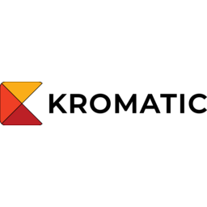

# Kromatic MCP servers

Kromatic runs three remote MCP servers. Each one is hosted by Kromatic and
connects over Streamable HTTP, so there is nothing to install or run locally.
This repository holds only listing material: install snippets, logos and
copies of each server's `server.json`. The server code is not here.
Maintained by [Kromatic](https://kromatic.com).

## Quick start

No API key is needed to start: each server has a free tier without sign-in.

```sh
# Claude Code
claude mcp add --transport http neumann https://neumann.kromatic.com/mcp
claude mcp add --transport http fermi https://fermi.kromatic.com/mcp
claude mcp add --transport http krobot https://api.kromatic.com/mcp/krobot

# Gemini CLI (adds all three)
gemini extensions install https://github.com/Kromatic-Innovation/kromatic-mcp
```

For Cline and other clients, use the config blocks under each server below.

| Server | What it does | MCP URL |
| --- | --- | --- |
| [Neumann](#neumann) | Monte Carlo ranges for uncertain plans: project cost, budget, timeline, capacity, NPV/IRR/payback. | `https://neumann.kromatic.com/mcp` |
| [Fermi](#fermi) | Calibrated probability ranges for forecasting questions, with the assumptions behind them. | `https://fermi.kromatic.com/mcp` |
| [Krobot](#krobot) | Test demand and willingness to pay before you build; decide whether to keep funding, change or stop. | `https://api.kromatic.com/mcp/krobot` |

The one-line descriptions are each server's own `server.json` description.

The Gemini CLI command installs the
[`gemini-extension.json`](gemini-extension.json) in this repository, which adds
all three servers.

The logo images are the Kromatic brand mark. The three servers share it, so
some per-server files are identical.

## Neumann


Neumann runs Monte Carlo simulations of a model, so you get a realistic range
of outcomes and their odds instead of one guessed number: project cost and
budget estimates, schedules and delivery dates, capacity and staffing, revenue
and growth, and investment returns such as NPV, IRR and payback.

**Free tier, no sign-in:** 3 free runs per UTC day, each with at most 1,000
trials and 20 nodes. Signed in with a free Kromatic account, you get 10 free
runs per UTC day, each with at most 10,000 trials and 50 nodes. With an
account, a run costs 1 credit (small) or 5 (large), currently $0.50 per
credit, and a new account starts with 5 free credits. Current price:
https://neumann.kromatic.com/billing/pricing

Cline (`cline_mcp_settings.json`):

```json
{
  "mcpServers": {
    "neumann": {
      "type": "streamableHttp",
      "url": "https://neumann.kromatic.com/mcp"
    }
  }
}
```

Claude Code: `claude mcp add --transport http neumann https://neumann.kromatic.com/mcp`

Docs: https://kromatic.com/mcp/neumann?utm_source=kromatic-mcp-repo&utm_medium=mcp-directory&utm_campaign=neumann

## Fermi



Fermi answers forecasting questions with calibrated estimates: how much or how
many, or whether an event will happen by a date. Each answer is a range plus a
probability distribution, with the reasoning and assumptions behind it.

**Free tier, no sign-in:** 3 free tier-1 estimates per UTC day. With an
account, tier 1, 2 and 3 estimates cost 1, 3 and 10 credits at $0.50 per
credit, and a new account starts with 3 credits.

Cline (`cline_mcp_settings.json`):

```json
{
  "mcpServers": {
    "fermi": {
      "type": "streamableHttp",
      "url": "https://fermi.kromatic.com/mcp"
    }
  }
}
```

Claude Code: `claude mcp add --transport http fermi https://fermi.kromatic.com/mcp`

Docs: https://kromatic.com/mcp/fermi?utm_source=kromatic-mcp-repo&utm_medium=mcp-directory&utm_campaign=fermi

## Krobot


Krobot helps people get evidence before they commit money: test an idea
before building it, and decide as a team whether to keep funding a project,
change direction or stop. It gives you Kromatic's step-by-step methods, real
company examples and templates as text and links. It does not run experiments
for you.

**Free:** browsing, searching and reading need no sign-in. Downloading a
template and sending feedback need a free Kromatic account. No Krobot tool
charges money.

Cline (`cline_mcp_settings.json`):

```json
{
  "mcpServers": {
    "krobot": {
      "type": "streamableHttp",
      "url": "https://api.kromatic.com/mcp/krobot"
    }
  }
}
```

Claude Code: `claude mcp add --transport http krobot https://api.kromatic.com/mcp/krobot`

Docs: https://kromatic.com/mcp/krobot?utm_source=kromatic-mcp-repo&utm_medium=mcp-directory&utm_campaign=krobot

## Notes for MCP clients

- The JSON blocks above use the Cline `cline_mcp_settings.json` shape. Other
  clients use the same URL with their own config keys (for example `httpUrl`
  in Gemini CLI, or `"type": "http"` in some clients).
- Prices and limits change. Each server reports the current ones itself:
  call its `check_account_and_credits` tool (Neumann and Fermi), or read its
  instructions when your client connects.
- Each server's registry entry is in the
  [official MCP Registry](https://registry.modelcontextprotocol.io) under
  `io.github.Kromatic-Innovation/<server>`. Copies are in
  [`server.json/`](server.json/).

## Security and privacy

- Each server is a network service run by Kromatic. Whatever your MCP client
  sends in a tool call (questions, model inputs, search terms) goes to that
  server.
- Privacy and terms: Neumann
  ([privacy](https://neumann.kromatic.com/privacy),
  [terms](https://neumann.kromatic.com/terms)); Fermi
  ([privacy](https://fermi.kromatic.com/privacy),
  [terms](https://fermi.kromatic.com/terms)); Krobot
  ([privacy](https://kromatic.com/privacy),
  [terms](https://kromatic.com/terms)).
- No credentials are needed for the free tiers. When you want an account,
  sign in through your MCP client where it supports it. If you use an API
  key, keep it in your client's configuration or an environment variable,
  not in a chat message.
- To report a vulnerability, see [SECURITY.md](SECURITY.md).

## Operational expectations

These are hosted services. What you can and cannot rely on today:

- **Status and uptime:** there is no public status page and no SLA.
- **Tool changes:** a change to a server's tools is not announced through
  this repository. It shows up as a new version in that server's MCP
  Registry entry, and in the tool list and instructions your client gets
  when it connects. This repository's weekly CI run compares the
  `server.json/` copies with the registry, so a new server version appears
  there as a failed drift check.
- **What happens to tool inputs:** each privacy policy states its retention
  rules. In short, from those pages as they read on 2026-11-12: Neumann keeps account data until you
  delete the account, and anonymous tool-call results can be fetched for 24
  hours and are deleted within 30 days. Fermi keeps account data, submitted
  content and results until you delete the account, and keeps anonymous
  questions and results without the anonymous fingerprint after 30 days.
  Krobot's policy (the connector section of the Kromatic privacy page) sets
  no fixed retention limit on tool-call records and keeps them for as long
  as your account exists. You can ask for deletion by email. The policies
  can change, and the linked pages are the full and current terms.
- **Problems:** report outages or errors with the server's feedback tool or
  to innovate@kromatic.com.

## Versioning

The version in `gemini-extension.json`, and the matching `vX.Y.Z` tag, cover
this repository's listing material: the server list, the MCP URLs and the
install snippets. It is not any server's version; each server versions
itself (see `server.json/`).

- MAJOR: a server is removed or renamed, or an MCP URL changes.
- MINOR: a server is added.
- PATCH: wording, logos or refreshed `server.json` copies.

Changes are listed in [CHANGELOG.md](CHANGELOG.md).

### What the version promises, and what it does not

- **Covered:** the three server names, their MCP URLs and the install
  snippets. If one of these changes, this repository gets a MAJOR version,
  a tag and a CHANGELOG entry. Watch the repository's releases to hear
  about it.
- **Not covered:** each server's tools (names and arguments), prices and
  free-tier limits. Those belong to the server and can change between
  releases of this repository. Each server reports its own version in its
  MCP Registry entry and in `server.json/`, and describes its current tools
  and limits when your client connects.
- **Hosting:** the servers are hosted by Kromatic only. There is no
  self-hosted version.

## Repository contents

| Path | What it is |
| --- | --- |
| `gemini-extension.json` | Gemini CLI extension manifest that adds all three servers. |
| `server.json/<server>.json` | Copies of each server's MCP Registry entry; see [`server.json/README.md`](server.json/README.md) for where they came from. |
| `logos/<server>-256.png`, `logos/<server>-512.png` | Logos for directory listings. |
| `cline/<server>-400.png` | 400x400 icons for the Cline MCP marketplace. |
| `scripts/check.py` | Consistency check run in CI: valid JSON, matching URLs across the manifests and README, and (with `--live`) drift against the MCP Registry and the README's prices and free-tier figures against what each server says live. |

The `server.json/` folder is named for the file each server publishes. It is
a directory of copies, not a manifest for this repository.

Run the checks with `python3 scripts/check.py` (add `--live` to compare
against the registry). They need Python 3.9+ and no dependencies.

## Support and contributing

Email innovate@kromatic.com, use each server's `send_feedback` (Neumann,
Fermi) or `feedback` (Krobot) tool, or open an issue here if a listing detail
is wrong or out of date. See [CONTRIBUTING.md](CONTRIBUTING.md).

## License

The text and configuration files are MIT licensed; see [LICENSE](LICENSE).
The Kromatic, Neumann, Fermi and Krobot names and logos are trademarks of
Kromatic and are not covered by that license.
